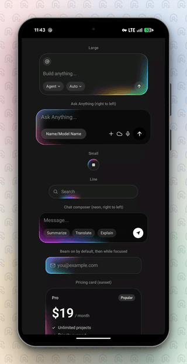
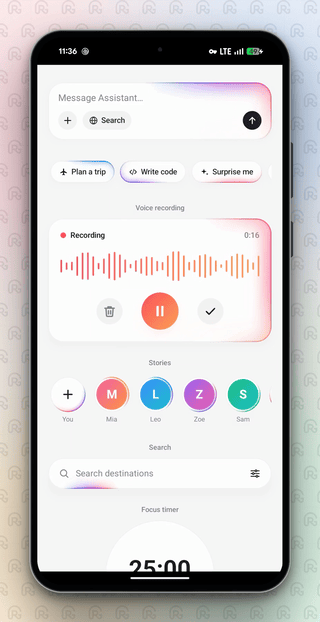

<div align="center">

| Dark | Light |
| :---: | :---: |
|  |  |

</div>

<h1 align="center">BorderBeam</h1>

A beautifully animated border beam for Jetpack Compose — with AGSL shader rendering and custom colors.

[](#)
[](./LICENSE)
[-lightgrey.svg)](#installation)
[](#contributing)

* * *

## ✨ Features

- 🧩 **Wrap anything**: text fields, buttons, cards or plain composables
- ⚡ **One GPU pass**: beam and glow drawn by an AGSL shader, no blur layers, no per-frame gradient rebuilds
- 🔷 **Any shape**: rounded rectangle, capsule or circle, with seam-free glow on every one
- 🎨 **Your colors**: any `List<Color>`, a single color, or ready-made palettes
- 🔀 **Direction, intensity, timing and speed** as parameters
- 🎯 **State-driven**: drive `active` from anything (focus, loading, recording) with a smooth fade
- 🌓 **Dark and light surfaces**
- ♿ **Animations-off aware**: shows a still beam
- 📱 **Works on Android 7.0+**: the shader runs on Android 13+, older versions use a lighter Canvas fallback

* * *

## Installation

**JitPack**: add the repository, then the dependency (check the build page on
[jitpack.io](https://jitpack.io/#ismnoiet/border-beam-android) for the exact coordinates of each tag):

```kotlin
// settings.gradle.kts
dependencyResolutionManagement { repositories { maven("https://jitpack.io") } }

// app/build.gradle.kts
dependencies { implementation("com.github.ismnoiet.border-beam-android:borderbeam:1.0.0") }
```

**Local Maven**: `./gradlew :borderbeam:publishToMavenLocal`, add `mavenLocal()`, then
`implementation("com.github.ismnoiet:border-beam-android:1.0.0")`.

**As a module**: copy `borderbeam/` into your project and `include(":borderbeam")`.

### Requirements

| Platform | Minimum |
|---|---|
| Android | 7.0 (API 24) |
| Shader (AGSL) | 13 (API 33), older versions use the Canvas fallback |
| Kotlin / Compose compiler | 1.9.22 / 1.5.10 |
| Jetpack Compose | BOM 2024.02.00 |

* * *

## Quick start

```kotlin
import com.ismnoiet.borderbeam.*

@Composable
fun Prompt() {
    var text by remember { mutableStateOf("") }

    BorderBeam(
        shape = BeamShape.rounded(26),
        colors = BeamPalette.spectrum,
        modifier = Modifier.width(320.dp),
    ) {
        BasicTextField(text, { text = it }, Modifier.padding(16.dp))
    }
}
```

Other shapes and styles:

```kotlin
BorderBeam(BeamStyle.small, shape = BeamShape.circle) { StopIcon() }
BorderBeam(BeamStyle.line, shape = BeamShape.capsule) { SearchField() }   // sweeps along the bottom edge
BorderBeam(direction = BeamDirection.rightToLeft, intensity = 0.75) { ... }
BorderBeam(colors = BeamPalette.single(Color.Cyan)) { ... }                        // one color
```

Only the beam, on a composable you style yourself:

```kotlin
MyCard(Modifier.borderBeam(shape = BeamShape.rounded(12)))
```

### Coming from iOS?

The names, parameter order and defaults match [border-beam-ios](https://github.com/ismnoiet/border-beam-ios), so a screen can be ported almost line by line:

```swift
// iOS
BorderBeam(.small, shape: .circle, direction: .rightToLeft, colors: BeamPalette.neon) { ... }
```

```kotlin
// Android
BorderBeam(BeamStyle.small, shape = BeamShape.circle, direction = BeamDirection.rightToLeft, colors = BeamPalette.neon) { ... }
```

* * *

## Props

`BorderBeam` (container) and `Modifier.borderBeam(...)` share these:

| Prop | Type | Default | Description |
|---|---|---|---|
| `style` | `BeamStyle` | `large` | `large` (comet + soft glow), `small` (tight ring), `line` (sweeps along the bottom edge) |
| `shape` | `BeamShape` | `rounded(26)` | `rounded(r)` (dp), `capsule`, `circle` |
| `direction` | `BeamDirection` | `leftToRight` | `leftToRight` (clockwise) or `rightToLeft` (counter-clockwise), judged along the top edge |
| `active` | `Boolean` | `true` | Fades the beam in/out, then stops the frame loop so idle beams cost nothing |
| `colors` | `List<Color>` | `BeamPalette.colorful` | First color is the tail, last is the head (up to 8 colors) |
| `intensity` | `Double` | `1.0` | Overall brightness, 0 to 1 |
| `timing` | `BeamTiming` | `BeamTiming()` | Lap, sweep and fade durations, in seconds |
| `surface` | `Color?` | `Color(0.11f)` | Container only. Background fill, `null` for none |
| `borderColor` | `Color` | `white 8%` | Container only. Hairline border |
| `modifier` | `Modifier` | `Modifier` | Container only. Standard Compose `Modifier` |
| `content` | `@Composable BoxScope.() -> Unit` | n/a | Container only. Anything you like |

> The container has two overloads: `BorderBeam(style, ...)` for the iOS-style call, and `BorderBeam(...)` with `style` left out (default `large`). In both, `modifier` is the first optional parameter, as Compose expects.

* * *

## Colors and palettes

Pass any `List<Color>`. Ready-made palettes:

| Palette | Look |
|---|---|
| `BeamPalette.colorful` | Green, blue, purple, pink, orange (default) |
| `BeamPalette.gemini` | Blue, purple, red, orange, yellow, green |
| `BeamPalette.spectrum` | Blue, teal, cyan, green, yellow, orange, red |
| `BeamPalette.neon` | Cyan, blue, violet, magenta |
| `BeamPalette.sunset` | Gold, orange, coral, purple |
| `BeamPalette.aurora` | Mint, sky, indigo, lilac |
| `BeamPalette.silver` | Cool, subtle white-blue |
| `BeamPalette.mono` | White |
| `BeamPalette.single(color)` | One color, fading in and out along its length |

```kotlin
BorderBeam(colors = BeamPalette.single(Color(0.25f, 0.85f, 0.5f))) { ... }
```

* * *

## Direction

```kotlin
BorderBeam(direction = BeamDirection.leftToRight) { ... }   // default, clockwise
BorderBeam(direction = BeamDirection.rightToLeft) { ... }   // counter-clockwise
```

* * *

## Timing and speed

```kotlin
BorderBeam(timing = BeamTiming(rotateDuration = 4.5)) { ... }   // slow lap

BeamSpeed(1.5) { Column { ... } }   // speed for every beam inside (1 = normal)
```

| `BeamTiming` field | Default | Description |
|---|---|---|
| `rotateDuration` | `2.4` | Seconds for one full lap (`large`, `small`) |
| `lineDuration` | `2.0` | Seconds for one there-and-back sweep (`line`) |
| `fade` | `0.6` | Fade in/out when `active` changes |

> `BeamSpeed` can change while a beam is running; it speeds up or slows down smoothly without jumping.

* * *

## Any content, any state

Controls inside the beam behave normally. Drive `active` from any state, for example focus:

```kotlin
@Composable
fun FocusField() {
    var email by remember { mutableStateOf("") }
    var focused by remember { mutableStateOf(false) }

    BorderBeam(
        shape = BeamShape.rounded(16),
        active = focused,
        colors = BeamPalette.aurora,
    ) {
        BasicTextField(
            email, { email = it },
            Modifier.padding(16.dp).onFocusChanged { focused = it.isFocused },
        )
    }
}
```

* * *

## Example app

The `borderbeam-demo` module holds the examples. Open the project in Android Studio and use the Compose previews, or show `BorderBeamExamples()` / `BorderBeamExamplesLight()` from an activity.

| Demo | Shows |
|---|---|
| Large, Ask Anything | Prompt cards, spectrum palette, right to left |
| Small | Round stop button |
| Line | Search bar |
| Chat composer | Neon palette, right to left |
| Beam while focused | `active` driven by focus |
| Pricing card | Sunset palette |
| Now playing | Slow silver beam |
| Toast | Single color, fast lap |
| Avatar + gradient button | Small style on circle and capsule |
| Single color | Blue, green, white |
| Light theme | AI composer, voice recording, stories, search, focus timer |

Source: [`Examples.kt`](./borderbeam-demo/src/main/java/com/ismnoiet/borderbeam/demo/Examples.kt), [`ExamplesLight.kt`](./borderbeam-demo/src/main/java/com/ismnoiet/borderbeam/demo/ExamplesLight.kt)

* * *

## How it works

Each beam is one AGSL `RuntimeShader` drawn over the content. The crisp edge is measured along the border itself, and the soft glow is a chain of Gaussian blobs laid along the beam's path, so it needs no blur layers and can't produce seams on any shape. All lengths are in dp, so it looks the same on every density. The beam's position is accumulated frame by frame, which is why the speed can change at any time without a jump. The frame loop stops when the beam is inactive, and turning animations off shows a still beam.

On Android below 13, where AGSL is not available, the beam is drawn with Canvas strokes along the border. It follows the same geometry and palette but is a lighter approximation of the glow.

* * *

## ⭐ Support

If you find this useful, give the repo a star.

## Contributing

Issues and PRs are welcome.

## License

MIT © [ismnoiet](https://github.com/ismnoiet)
